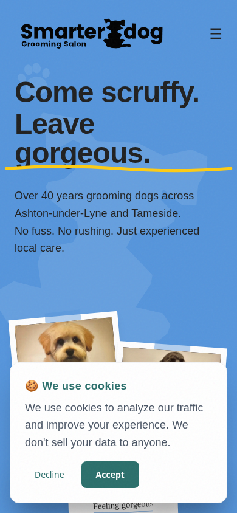
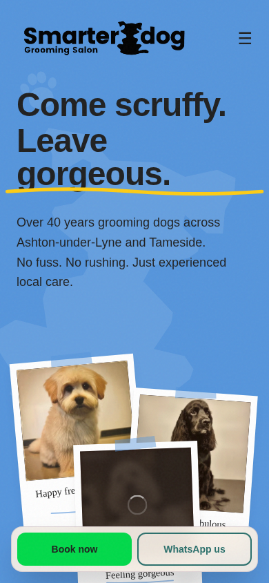
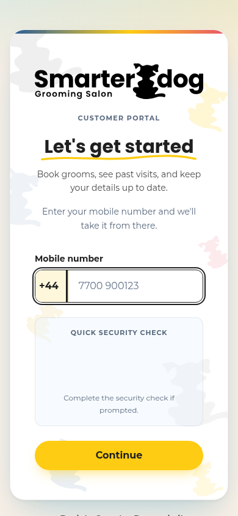
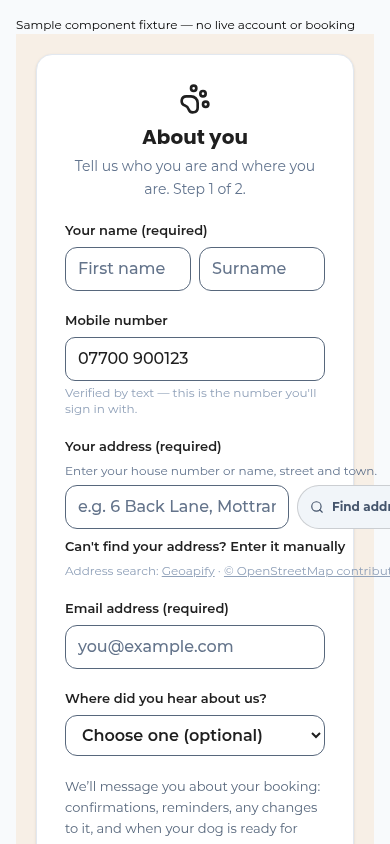
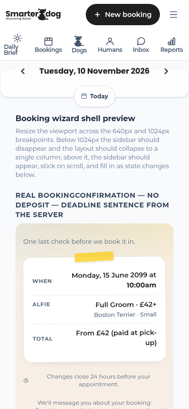
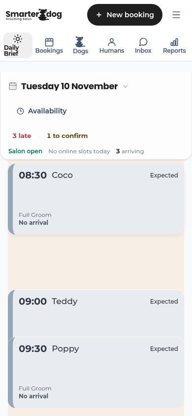
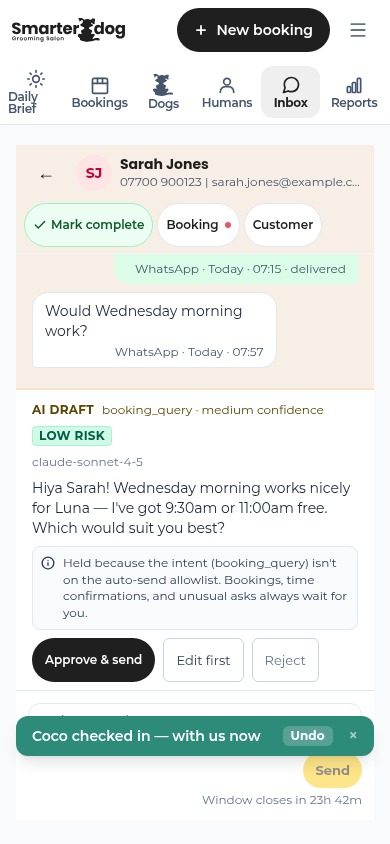
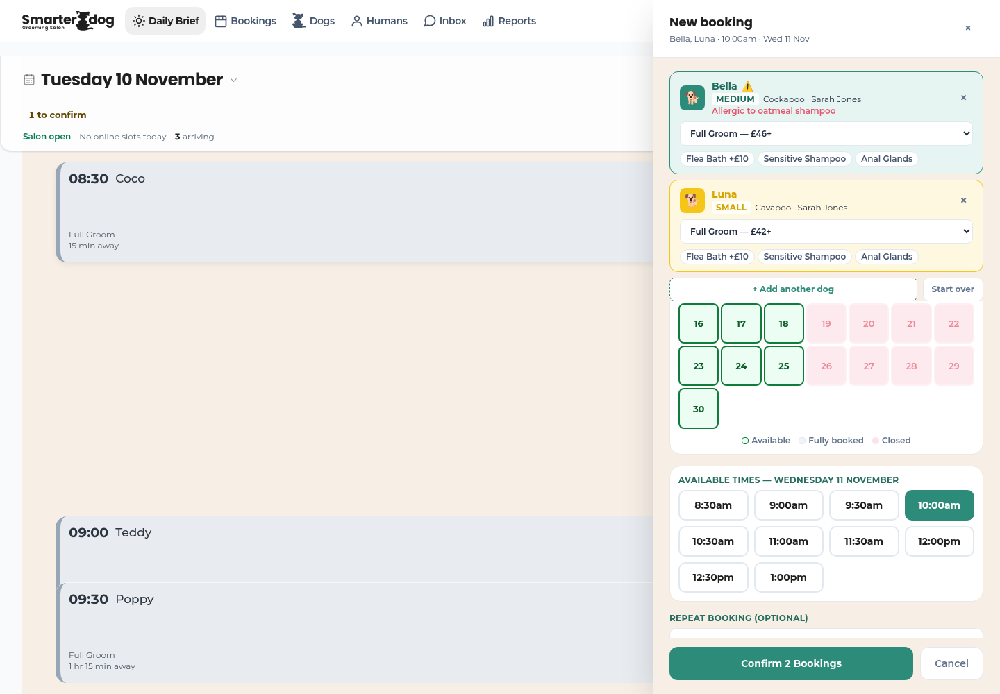
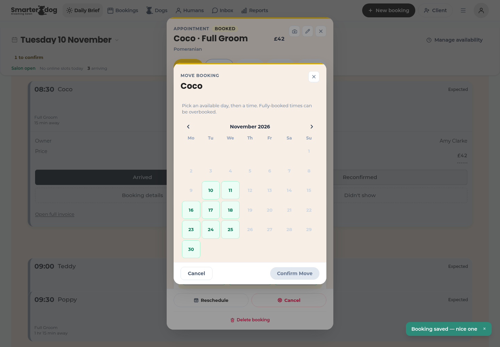

# Smarter Dog UX and UI audit

Status: Research; local visual evidence, with live-access limits
Date: 10 November 2026
Base: `origin/main@aa0929bd` (fresh `ux/ui-audit-2026-11` worktree)
Scope: website, customer portal, staff workspace and customer messages

## 1. Verdict

Smarter Dog feels like a caring local salon, and the software is considerably clearer than the older audits suggest. The strongest parts are the reassuring homepage, recognisable identity, explicit booking review and chronological staff day. The largest customer burden is committing to account and dog setup, then waiting for approval before choosing an appointment; this audit confirms that sequence, not how many customers abandon it. The largest staff risk is a recurring series whose saved, skipped and failed dates are not clearly reconciled. The website and portal already share their core colours and fonts, but competing booking-button colours, channel promises and terminology weaken the handoff. Phone friction is concentrated in the cookie overlay, some small controls and the expanded inbox, rather than every staff screen. Safe copy and visual corrections are queued below; changes to approval, appointment operations or approved messages need a separate decision. This is a local audit with source review: live pages could not be reached, and a complete authenticated customer booking could not be timed.

The ten priorities, before the detailed evidence:

| Rank | ID | Friction | Severity | Branch disposition |
|---|---|---|---|---|
| 1 | ST-01 | Recurring series has no usable account of partial results | High | Needs a decision |
| 2 | P-01 | Long signup and approval before choosing availability | Medium | Needs a decision; welcome copy queued |
| 3 | P-02 | Online reschedule can fail only at submission | Medium | Needs a decision |
| 4 | WEB-02 | First-visit cookie notice covers phone Book now | Medium | Awaiting a yes for layout/flow change |
| 5 | MSG-01 | Automatic messages expose service identifiers and inconsistent group facts | Medium | Needs a decision; sender files excluded |
| 6 | ST-02 | Reconfirmed and Confirm booking compete on one card | Medium | Needs a decision; engine excluded |
| 7 | ST-08 | Cancellation does not explain notification/Undo limits | Medium | Needs a decision |
| 8 | P-04 / ST-05 | Unnamed cancellation fields and 32px template controls | Medium | Safe attributes/visual fixes queued |
| 9 | WEB-01 | Main booking buttons change colour between contexts | Medium | Safe visual alignment queued |
| 10 | P-10 | Important appointment labels are 11px | Low | Safe 12px correction queued |

Ranking weighs the person affected, exposure and consequence. It is judgement, not a measured impact formula: traffic, conversion and error frequencies were not available. No Critical finding survived review.

## 2. Scorecard

Scores describe the reviewed local screens and source, before fixes. They are editorial assessments, not usability-study results or accessibility certification.

| Surface | Phone / 10 | Desktop / 10 | Why |
|---|---:|---:|---|
| Website | 7 | 8 | Warm, specific and recognisable; consent covers the phone booking action and action colours vary. |
| Portal | 6 | 7 | Clear controls and commitment facts; signup burden and several recovery dead ends. Dashboard/wizard scores are provisional because only component fixtures are runnable. |
| Staff | 7 | 8 | Chronological day and visible navigation work; expanded actions, inbox metadata and series recovery need attention. |
| Messages | 6 | 6 | Source-only copy score on both devices; actual notifications and lock-screen rendering unverified. |

| Lens | Score / 10 | Assessment |
|---|---:|---|
| Visuals | 7 | Good shared identity; small captions and raw template controls remain. |
| Language | 6 | Warm foundations; inaccurate delivery/window promises and service identifiers interrupt them. |
| Coherence | 7 | Shared palette/type already exist; actions and vocabulary drift. |
| Intuitiveness | 6 | Everyday staff actions are direct; new-customer and late-reschedule recovery are less obvious. |
| Elegance | 6 | Collapsed day is disciplined; expanded actions and optional signup details compete. |

## 3. Journeys and captured steps

All report screenshots are local sample data or explicitly marked component fixtures. No live customer screen was captured. The browser used system Chromium through Playwright, authorised as a fallback in this chat. Phone checks used 390 × 844 with touch enabled; desktop checks used 1440 × 1000. Additional boundary checks are recorded in the verification note. Non-local application requests, Supabase and outbound writes were blocked. Installed-app behaviour was not tested; service workers were blocked.

### Customer: homepage to booked slot

1. **Homepage, first visit — obstructed.** The cookie notice occupies the bottom of the 390px screen, above the fixed booking bar. Its Accept button, not Book now, is at the lower-centre hit point. Evidence: `CookieConsent.jsx:40`, `MobileQuickActions.jsx:14`; figure 1.
2. **After declining cookies — clear.** Book now is visible and 48px high. The bar offers booking and WhatsApp without making the customer find navigation; figure 2.
3. **Handoff to sign-in — locally clear, live blocked.** `website/src/constants/links.js:16` points directly to the same business at `/book/login`. Two taps reach the attempted handoff from a fresh homepage: Decline, then Book now. A returning visitor with stored consent needs one. Production navigation failed with `ERR_TUNNEL_CONNECTION_FAILED`, so there is no honest end-to-end loading time. The separately opened local `/book` correctly redirects to `/book/login`; figure 3.
4. **New customer setup — substantial, not a timed completion.** Source ordering is phone verification → welcome → password → two onboarding forms → manual approval → dashboard (`CustomerApp.jsx:152–223`). The first form requires identity, address, email and policy acceptance; the second requires dog identity, breed, sex and birth month/year. Figure 4 is the real onboarding component with synthetic props, not an authenticated account.
5. **Approval — a real pause.** `PendingApprovalGate.jsx:60–80` now names salon days, Mon–Wed, and gives WhatsApp recovery. There is no basis to promise a particular turnaround or count approval as a quick tap.
6. **Dashboard and five-step booking — incomplete fixture coverage.** The dashboard-card preview renders real components; the wizard preview renders real confirmation/sidebar/degraded calendar, with placeholders for selection steps. Figure 5 shows commitment facts. It does not prove a customer completed a booking. The source route is dog → service → date → time → review, with explicit confirmation. Returning customers can reuse a previous groom where eligible, but no full runtime tap count or completion time is claimed.

**Timing limit:** the complete new-customer and returning-customer journeys are unmeasured. A manual approval wait and unavailable authenticated sample mode prevent a credible single completion time. Script execution time would not represent a person's reading, typing or waiting.

### Staff: phone start, arrival and reply

7. **Daily Brief — healthy core hierarchy.** Date, availability and attention precede the chronological dog stack. A collapsed card states time, dog, status and timing in words; figure 6. At 08:15 sample time, opening Dog A and tapping Arrived updated the sample state and offered Undo.
8. **Replying — functional, dense.** Inbox → Customer A thread → reply field → Send completed using sample messages, without Generate reply or any external send. Starting from the loaded Daily Brief, the complete path took **six taps plus typing**: expand dog, Arrived, Inbox, thread, focus reply, Send. One scripted run took **10.6 seconds**, including automation waits; this is execution evidence, not a human task-time benchmark. Figure 7 shows the expanded thread. The arrival Undo toast temporarily overlapped the lower composer in this route; this is a residual cross-screen overlay risk, not proof every toast covers every action.

### Staff: desktop multi-dog appointment and move

9. **Two dogs — explicit review, healthy basic route.** A browser-only sample fixture gave two existing dogs the same owner; the shipped fixture otherwise has one dog per owner. New booking → search/select Dog A → Add another dog → Dog B → date → time → Confirm 2 Bookings → Don't send → Confirm booking completed locally. That is **nine clicks plus search typing**; search autofocus removes a separate focus click. One scripted run took **1.64 seconds**, with no reading time, so it is not a realistic staff speed claim. Figure 8 shows the real drawer before commitment; the following confirmation-method dialog is a meaningful extra choice.
10. **Move — sample verification recorded separately.** Expand dog → Booking details → Reschedule → date → time → Confirm Move is the six-control route. The original sample IDs are numeric but the Today opener passes strings (`useBookingActions.ts:548`, `App.jsx:395`), so Booking details silently did nothing in the unmodified sample. For this walkthrough only, intercepted sample-module responses converted numeric IDs to strings; no repository or production data changed. Live UUID behaviour must not be diagnosed from that fixture mismatch. Figure 9 shows the real move picker; final outcome and timing belong in the verification note.

### Screenshot evidence

Figures are ordered by the steps above; the full before/after pairs remain in the scratchpad. Some developer harness chrome is visible deliberately, so a component fixture cannot be mistaken for the complete portal.

## 4. Top ten, with evidence and decisions

| ID | What happens; why it matters | Evidence | Fix and effort | History; disposition |
|---|---|---|---|---|
| ST-01 | A series can omit unavailable dates or save some dates and fail others, then show one overall outcome. Staff cannot reconcile the intended series confidently. | `NewBookingModal.jsx:507–618`; `useStaffAppData.ts:221–234`. Source-confirmed; not a reproduced production incident. | Keep/skipped-date preview and per-date result/recovery; L. | Still open, October staff F9. Needs a decision; write paths excluded. |
| P-01 | New people give substantial information and wait for review before seeing availability. The welcome understates that commitment. | `CustomerApp.jsx:152–223`; `JoinThePackOnboarding.jsx:76–155`; figure 4. | Honest welcome copy S queued. Approval/required-field review L, needs a decision. | Still open, October U1/F15. No measured abandonment. |
| P-02 | Reschedule is offered without checking the existing appointment's deadline; definitive refusal arrives on submit. Original appointment stays safe. | `BookingCard.jsx:115–133,232–248`; `BookingWizard.tsx:766–783,905–906`. | Advisory early closed-state and contact recovery; M. | Still open for reschedule only. Needs a decision; cancellation rule has changed. |
| WEB-02 | First phone arrival has to resolve cookies before reaching the booking bar. This adds an interruption to the primary task. | Figure 1; bottom z50 consent above z40 actions. | Keep consent and booking simultaneously reachable; S/M. | New. Awaiting a yes for changed layout/flow; consent semantics unchanged. |
| MSG-01 | Automatic copy can say `bath-and-brush`; a grouped confirmation uses one triggering service for all dogs. Reminder grammar can say “Dog A and Dog B is booked”. | `notify-booking-confirmed/index.ts:105–164`; `notify-booking-reminder/index.ts:155–167,430`; `whatsappTemplates.js:99`. | Canonical labels and accurate group wording, then approved-template process; M. | New. Needs a decision; no sender/template edit on this branch. |
| ST-02 | An unconfirmed appointment can expose Reconfirmed and Confirm booking, whose reporting effects differ. The choice looks like repetition. | `salonBoard.ts:522–529,562–567`; `useBookingActions.ts:322–340,475–492`; figure 6 expanded state. | One deliberate confirmation affordance; M. | Still open, October F5. Needs a decision; engine excluded. |
| ST-08 | Cancel explains records, but not the possible customer notice; Undo restores diary state and cannot recall a notice already sent. | `BookingActions.jsx:122–160`; cancellation handler and status-trigger definitions, checked independently. | Explain notification and Undo limits; S copy, but requires wording decision. | Still open, October F7. Delivery/activation unverified; do not promise all customers were notified. |
| P-04 / ST-05 | Cancellation reason/Other fields lack accessible names; template selector, fields and Send are 32px high even with a coarse pointer. | `BookingCard.jsx:262–280`; `TemplatePicker.jsx:115,134,161,174`; measured fixture 32px at 390 and 1440. | Add accessible names; 44px coarse-pointer controls with desktop density retained; S. | Still open/partly fixed from older audits. Safe fixes queued. |
| WEB-01 | Website nav and phone booking are green; hero/portal are yellow; service booking buttons vary by service colour. | `Navigation.jsx:110–119,190–197`; `MobileQuickActions.jsx:37`; `ServicesPage.jsx:77–85`; figure 2. | Use existing yellow/charcoal for these booking actions; S. Preserve WhatsApp and frozen operational colours. | New. Safe visual fix queued. |
| P-10 | When/Total/Deposit labels render at 11px, below the declared useful-text floor. | `customer-portal.css:508–515`; figure 5; computed 11px at 390/1440. | Raise `.portal-detail-label` to 12px and recheck wrapping; S. | Still open caption debt. Safe fix queued; other 11px selectors remain separately listed. |

**Adversarial review:** a separate checker challenged every proposed High. Signup and late rescheduling were downgraded to Medium: burden exists, but measured conversion loss and serious booking loss do not. ST-01 retains High only for series-result ambiguity. Same-day multi-dog writes are atomic, and duplicate rejection mitigates retries; claims of partial dog groups or certain duplicate appointments were rejected. No Critical survived. The cancellation finding remains Medium with channel/activation uncertainty.

## 5. Everything else

### Website

| ID | Finding and evidence | Recommendation; effort; disposition |
|---|---|---|
| WEB-03 | Homepage extra services do not say walk-in/no booking, unlike Services. `sections/ServicesSection.jsx:132–223`; `pages/ServicesPage.jsx:105–120`. | Add existing-policy clarification; S, safe copy queued. |
| WEB-04 | Puppy Groom has no local Book button in Services; the page lacks the homepage quick bar. `ServicesPage.jsx:63–104`. | Consider direct route for all four services; S/M, awaiting a yes. |
| WEB-05 | Noninteractive service cards lift/scale as if clickable. `ServiceCard.jsx:5–8`. | Remove misleading motion or make an intentional destination; S, needs design choice. |
| WEB-06 | Cookie copy uses “analyze”. `CookieConsent.jsx:47`. | “Analyse”; S, safe copy queued. |
| WEB-07 | `.body-font` fixes 18px outside Tailwind layers, so some utility sizes do not determine rendered size. `website/src/index.css:24–28`. | Verify hierarchy case by case; preserve readability baseline. No global reset. |
| WEB-08 | Seasonal popup repeats on each visit; public opening hours end at 15:00 while bookable drop-offs end at 13:00. | Decide persistence and whether hours need “last drop-off” clarification. Neither is proved false opening information. |

### Portal

| ID | Finding and evidence | Recommendation; effort; disposition |
|---|---|---|
| P-03 | Unknown first-booking failure calls it a “booking change”. `BookingWizard.tsx:917`. | Neutral appointment wording; S, needs a decision because current test pins wording. |
| P-05 | Canonical-breed helper says size will be confirmed before online booking, even though it already derives a size. `AddDogInline.tsx:82–84`. | “Size guide: … Availability is checked when you book”; S, safe copy queued. |
| P-06 | Trusted-human addition is “temporarily unavailable” without a useful route. `TrustedHumansSection.jsx:89–94`. | Truthful contact guidance; S, needs a decision because test pins capability wording. |
| P-07 | Welcome says “takes a minute” and “text you”, despite substantial setup and WhatsApp-first welcome. `JoinThePackWelcome.jsx:37–40`. | Explain setup/review; “message you”; S, safe copy queued. |
| P-08 | Add to calendar returns silently on null token/URL. `AddToCalendarButton.tsx:26–37`. | Visible failure/recovery state; S/M, missing-state work deferred pending fixture coverage. |
| P-09 | Date/time is labelled Booking ref, although it is not a unique appointment identifier. `BookingWizard.tsx:975–977,1094–1097`. | Remove or rename redundant label; S, proposal only. Preserve real deposit references. |
| P-11 | Editing breed to an unrecognised value can remove online eligibility without a prewarning. `DogsSection.jsx:92–108,136–142`. | Explain size review before save; M, needs a decision about eligibility wording. |
| P-12 | Waitlist success names a dog although write passes human/date, and dashboard offers no waitlist management. `BookingWizard.tsx:930–933,1024`. | Align receipt to actual scope; M, needs a decision/write-boundary review. |
| P-13 | Some weekday/kicker/size-note selectors are still 11px. | Continue targeted readability review; not all are corrected by the detail-label fix. |

### Staff

| ID | Finding and evidence | Recommendation; effort; disposition |
|---|---|---|
| ST-03/04 | Template UI says a send reopens the chat and promises receipt. `TemplatePicker.jsx:64,106`. | Explain that customer reply opens free replies; report submission without guaranteeing delivery; S, safe copy queued. |
| ST-06 | Context panel lacks the upcoming appointment relevant to a move/cancel enquiry. `useCustomerContext.js:99–109,149–162`. | Upcoming summary and link; M, needs a decision. |
| ST-07 | Unknown-sender guidance suggests a profile without a link/create path. `CustomerContextPanel.jsx:125–126,293–301`. | Provide an explicit supported route; M, needs a decision. |
| ST-09 | Edit-mode moves append scheduling stamps to permanent groom notes. `useBookingSave.ts:160–170,217–225`. | Separate appointment history from groom instructions; M, write-path decision. |
| ST-10 | Future dates can say “No online slots today”. `TodayHeader.jsx:34–38`. | Keep today's wording; use “on this day” for other dates; S, safe copy queued. |
| ST-11 | Prior-day backlog remains in Tools rather than the day summary. `AppToolbar.jsx:212,352`. | Consider prior-day link/count; M, awaiting a yes. |
| ST-12 | Expanded cards contain many competing actions; collapsed chronology works. `StackActions.jsx:26–39,79–110`. | Group secondary work only after a flow decision. Do not shrink safety information. |
| ST-13 | Arrival Undo toast can overlap the inbox composer after navigation. Figure 7. | Context-aware toast placement/expiry; M, needs visual design choice across routes. |
| ST-14 | Unmodified sample Booking details cannot match numeric IDs after string conversion. | Sample-harness limitation, not a claimed production UUID defect; S/M future developer fix. |

### Messages

| ID | Finding and evidence | Recommendation; effort; disposition |
|---|---|---|
| MSG-04 | Approval welcome has no book link; fallback paw emoji changes SMS encoding. `notify-customer-welcome/index.ts:243–245`; `whatsappTemplates.js:185`. | Give the next action and review SMS encoding; S/M, needs a decision/provider approval. |
| MSG-05 | Automatic SMS often omits salon attribution. Manual collection copy includes it. | Put Smarter Dog early where sender identity is otherwise unclear; source-level risk, live sender ID unverified. Needs a decision. |
| MSG-06 | Salon cancellation fallback says “Rebook anytime” without apology/remedy; approved WhatsApp wording is more empathetic. `notify-booking-cancelled/handler.ts:61,313`. | Distinguish salon apology from customer acknowledgement; S, sender change excluded. |
| MSG-07 | Voice guide says no email templates were found, but plain-text email renderers exist. | Correct bounded documentation; no sending or provider change. |
| MSG-UI-01 | Staff reminder preview exposes Meta/internal-template jargon and claims full visual equality. `WhatsAppComposer.jsx:24–25`. | Explain approved wording and checking details; S, safe frontend copy proposed. |

`notify-waitlist-joined` is a staff alert, not a missing customer receipt. Do not score it as customer lock-screen copy. Message source review covers confirmations, reminders, cancellation, welcome, waitlist and assistant fallbacks; actual delivery, rendering and truncation are unverified.

## 6. Coherence, side by side

| | Website | Portal | Staff | Messages |
|---|---|---|---|---|
| Colour | Charcoal, cream, sky; varied booking fills | Same core palette; yellow booking | Same core palette; status-coloured next actions | Provider/channel presentation; no single visual skin promised |
| Type | Montserrat/Poppins; limited hero face | Montserrat/Poppins | Montserrat/Poppins | Customer's device/provider fonts |
| Buttons | Bespoke cards/nav/actions | Portal controls | Shared Button/IconButton plus raw exceptions | Template/compose actions belong to staff UI |
| Components | Friendly images and service cards | Familiar logo, tape/detail rows | Quiet cards, stack, modal shells | Source renderers and approved template registry |
| Voice | Playful local reassurance | Warm, sometimes overpromising setup | Calm, occasionally technical | Conversational recovery good; automation less consistent |
| Terms | Book/visit/services | Grooms/bookings/appointments | Humans/Client/customer; Daily Brief/Bookings | Canonical service names inconsistently mapped |

The three applications do not need merged CSS, routing or service workers to feel related. The relevant work is consistent action meaning, facts, vocabulary and readable controls.

## 7. Language rewrites

| Current | Proposed | Disposition |
|---|---|---|
| “It takes a minute … text you” | “Choose a password, then tell us about you and your dog. The team will review your details and message you when you're ready to book.” | Safe welcome copy queued; no SLA invented. |
| “Send a template to reopen the chat” | “Send an approved template. You can reply freely once the customer responds.” | Safe staff explanation queued; approved body unchanged. |
| “The customer will receive the message shortly” | “Template submitted. Check its delivery status in the conversation.” | Safe outcome wording queued. |
| “Estimated size … we'll confirm this before online booking” | “Size guide: … Availability is checked when you book.” | Safe helper copy queued. |
| “analyze our traffic” | “analyse our traffic” | Safe UK spelling queued. |
| Homepage extra services with no booking guidance | “Walk-ins — no booking needed” | Safe existing-policy clarification queued. |
| “No online slots today” on another date | “No online slots on this day” | Safe contextual wording queued; current-day contract preserved. |
| Raw `bath-and-brush` | “Bath & Brush” | Sender mapping needs a decision. |
| “Rebook anytime” after salon cancellation | Apologise, name the cancelled appointment, offer help rearranging. | Sender/template decision. |
| “Sent via Meta as [internal name]…” | “This message uses approved wording. Check the details below before sending.” | Frontend-only proposal. |

## 8. Challenged decisions and hypotheses

| Decision/hypothesis | Case for | Case against; judgement |
|---|---|---|
| Website-to-slot takes too many steps | Verification, dog facts and review protect salon work. Handoff is same-origin. | Setup and approval precede availability. **Refined:** the burden is account/gate ordering, not a chain of different websites. No measured conversion loss. |
| Signup loses people | Strong first-visit burden is visible and source-confirmed. | No funnel evidence supplied. **Unproven outcome; confirmed friction.** Keep safeguards until a decision. |
| Three surfaces look like unrelated brands | Different layouts suit marketing, self-service and operations. | Core colour/type/logo already agree. **Mostly refuted; action and language inconsistencies remain.** |
| Staff app is too dense everywhere | Operations require more state than marketing. Collapsed stack prioritises time/status. | Expanded actions and inbox metadata compete. **Refined to specific states, not a global density verdict.** |
| Humans | Warm, includes trusted carers who are not paying customers. | Less obvious to a new staff member; Client/customer elsewhere. Consider People + “Customers and trusted contacts”; decide deliberately. |
| Compact login | Limits distraction and keeps one next action. | Long branding/security block pushes the website-return link below the fold at 390px. Actual Turnstile size/OTP states unverified; no speculative widget clipping finding retained. |
| Today stack | Time order answers who arrives next and elapsed time; words supplement colour. | Large deliberate geometry can leave quiet space; expanded secondary actions repeat concepts. Keep chronology; test regrouping, not indiscriminate compression. |
| Yellow means action | Consistent lead action is learnable, with strong charcoal contrast. | Website uses green and staff next actions use status themes. Align straightforward booking controls; do not reinterpret WhatsApp or operational state colours. |
| Frozen status colours | Protect established scanning and safety meanings. | Frozen colours do not exempt poor text contrast or colour-only state. Preserve tokens; strengthen labels, targets and non-colour cues. |
| Multiple move entries | Drag is efficient for mouse; modal serves touch/keyboard; edit also changes service. | Different side effects and recovery are the problem. Do not delete useful entry points merely to reduce a count. |

## 9. What works

Keep the specific local homepage promise and recognisable dog identity; direct same-origin booking links; consistent bookable service names and guide prices; visible phone section navigation; time-ordered staff cards with status words and safety information; explicit commitment/deposit facts; Undo for reversible sample staff state; OTP resend; Mon–Wed approval expectations; independently loading dashboard resources; and delivery states that distinguish an attempted send from confirmed delivery. Older audits' false-success findings for drag, reschedule and status changes are fixed in the cited current paths. These are material improvements, not reasons to retain stale findings.

## 10. What could not be verified

- Live website and login: browser navigation failed with `ERR_TUNNEL_CONNECTION_FAILED`. No live staff sign-in was attempted; no passwords, accounts, bookings or production controls were changed.
- Real-volume staff layout, long real records, busy-day behaviour and provider thread history: no shared signed-in browser. Sample records cannot establish production density.
- Complete customer dashboard/wizard: `/book` stops at local login; the existing harnesses are partial. No pretend completed customer journey or invented tap/time total.
- Security widget, SMS/WhatsApp receipt, screen-reader speech, native keyboard, push, device notification previews and installed service-worker lifecycle: untested. Screenshot/DOM inspection does not prove WCAG compliance or delivery.
- Recurring partial results: static path proof plus independent challenge, not a database/runtime fault-injection experiment. No database was touched.
- Production migration/feature activation and configured public hours/sender IDs: not queried.
- Historical status is bounded to current evidence. The [prior-findings ledger](2026-11-10-ux-ui-audit/prior-findings.md) covers all 159 June digest IDs and the named June/October/August UX findings. It explicitly preserves rejected, superseded, partial and unverified entries instead of forcing a fictional fixed/open verdict. Non-UX security/operations findings are not silently rescanned here.

## 11. Fix plan and handoff

**Queued safe branch work:** WEB-01 booking fills; WEB-03 walk-in clarification; WEB-06 spelling; P-04 accessible cancellation names; P-05 truthful size helper; P-07 welcome expectations; P-10 detail-label size; ST-03/04 template guidance/outcome; ST-05 touch height; ST-10 selected-date wording. Each finding gets a separate commit after this report-first commit. No approved message body, auth, route, booking write path, engine or frozen colour token is changed.

**Awaiting a yes, not implemented:** WEB-02 keep booking reachable alongside consent; WEB-04 give Puppy Groom the same direct booking route; ST-11 surface prior-day work; ST-12 regroup expanded secondary actions. For each, the small proposal must state the exact change, benefit and regression risk before implementation. No such yes has been assumed from the Playwright fallback approval.

**Needs a decision:** signup ordering/required fields/approval; reschedule preflight; recurring result/retry model; confirmation semantics; cancellation disclosure and notification route; upcoming inbox context; breed eligibility recovery; approved templates/sender mappings; and strings pinned by contract tests. This branch cannot resolve them through cosmetic edits.

**Evidence and verification:** baseline screenshots and before/after pairs live in the scratchpad, outside the repository. Accepted report figures are copied here from sample screens only. The [verification note](2026-11-10-ux-ui-audit/verification.md) records actual checks and remaining limits. A draft PR is the review boundary; no merge or deployment is authorised.
