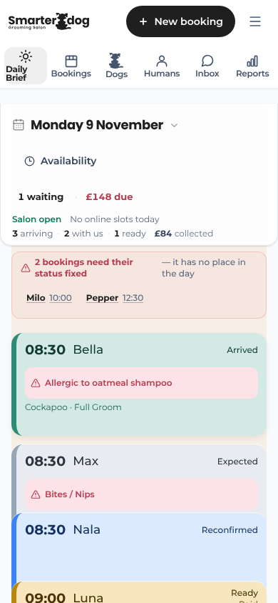
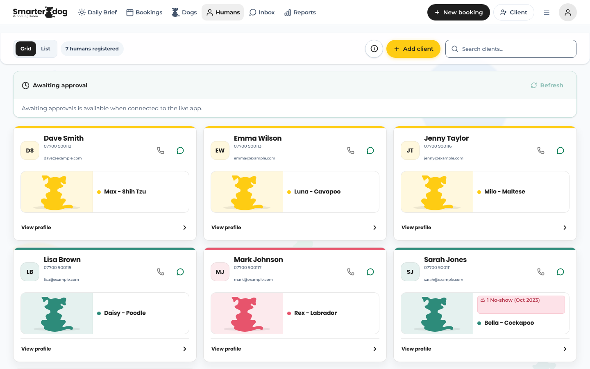
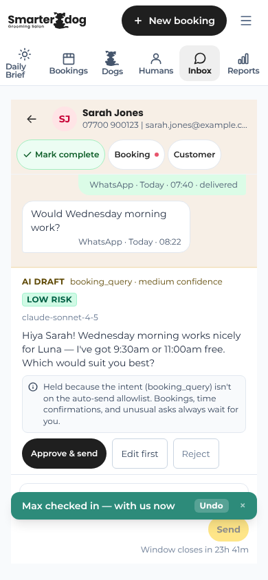

# Smarter Dog UX and UI audit: second pass

Status: Research; dated findings and recommendations, not a plan or a decision
Date: 11 November 2026
Base: `origin/main@cb7e653` (after the 10 November audit merged as #1200)
Scope: website, customer portal, staff workspace and customer messages

**Read this alongside the [10 November audit](2026-11-10-ux-ui-audit.md).** That audit ran
from the same brief and merged yesterday with twelve fixes. This is an independent second
pass. It does not repeat findings the first audit already holds; it says where it agrees,
where it disagrees, what the first could not see (it could not reach the live site), and
what it missed. IDs here start `N-` so they never collide with the first audit's.

## 1. Verdict

The first audit's verdict stands: this reads as one caring local salon, and the software is
clearer than the older audits suggest. I agree with its top ten and would not reorder the
top three. What it under-weighted is **language**. The staff app calls the same person a
Human, a client, a customer and an owner, sometimes four ways on one screen; the same
screen is "Daily Brief" in the menu and "Today" everywhere else; the calendar is "Bookings"
in the menu and "the diary" in the instructions. None of that breaks anything, but it is
the main reason the staff app feels busier than it is. The second gap is the **join between
website and portal**: the handoff is one tap and visually fine, yet the website never says
you will need an account, or that new accounts are checked before a first booking, so the
sign-in screen arrives as a surprise. Third, a few things promise what the salon does not
do: the sign-in error tells customers to "give the salon a ring" when there is no phone
line, and the Terms page says the salon offers "full grooms only". No Critical or High
finding survived the adversarial check. Most of what is new is small wording, and the safe part is fixed on this
branch.

### Top ten new or sharpened frictions

(N-10, the doubled security check, is written up in section 4 as an eleventh.)

Ranked by who it hurts × how often × how badly. "Sharpened" means the first audit has the
item and this adds evidence or changes the recommendation.

| Rank | ID | Friction | Severity | Status | On this branch |
|---|---|---|---|---|---|
| 1 | N-01 | The website never says booking needs an account, or that new accounts are checked first | Medium | New | Fixed (copy) |
| 2 | N-02 | One customer, four names in the staff app (Human, client, customer, owner) | Medium | New | Fixed (decided 11 Nov) |
| 3 | N-03 | Sign-in failure says "give the salon a ring"; there is no phone line | Low | New | Fixed (copy) |
| 4 | N-04 | Staff error messages are pale coral on pale coral, about 2.9:1 | Medium | New | Fixed (visual) |
| 5 | N-05 | AI draft cards show machine labels to salon staff | Medium | New | Fixed (copy) |
| 6 | N-06 | On a phone, more than half of the first Today screen is header before the first dog | Medium | New | Built and measured; not shipped. Needs a decision |
| 7 | N-07 | Three places change a status, with different safeguards | Low | New | Needs a decision |
| 8 | N-08 | Terms page says "full grooms only"; the salon sells four services | Medium | New | Fixed (wording approved 11 Nov) |
| 9 | N-09 | The approval wait does not say you can close the page, and the step before it says "you're all done" | Low | Sharpened (P-01) | Fixed (copy) |
| 10 | N-34 | Every no-show raises a red "needs its status fixed" alert on Today | Medium | New | Fixed in its own PR (12 Nov) |

## 2. Scorecard

Scores are editorial judgements of what I saw and read, before this branch's fixes. Where I
differ from the first audit by a point or more I say why.

| Surface | Phone | Desktop | Why |
|---|---:|---:|---|
| Website | 7 | 8 | Warm, specific, one-tap booking bar. Loses points for the cookie notice over that bar (first audit, WEB-02) and for not preparing people for sign-up (N-01). Seen live this time. |
| Portal | 6 | 7 | Sign-in is clean and on-brand. First-timers face nine screens and fourteen required fields before a wait. Dashboard and wizard seen only as component previews. |
| Staff | 6.5 | 7.5 | Half a point below the first audit on both. Desktop calendar is dense but well ordered; the phone Today screen spends its first half on chrome; vocabulary drifts. |
| Messages | 6 | 6 | Short, kind and grammatical in the main; three registers instead of the two the voice guide describes. Source only. |

| Lens | Score | One line |
|---|---:|---|
| Visuals | 7 | One recognisable identity. Debt is small text (8 to 11px in places) and a few low-contrast pairs. |
| Language | 5.5 | Warm foundations; the first audit said 6. Naming drift is wider than it reported. |
| Coherence | 7 | Website, portal and staff share ink, paper, yellow, Poppins and Montserrat. Messages are the least coherent part. |
| Intuitiveness | 6.5 | Everyday staff jobs are 5 or 6 taps. New customers are not told what is coming. |
| Elegance | 6 | The collapsed Today card is disciplined. Headers, expanded cards and the inbox draft card carry things that do not earn their place. |

## 3. The journey: website to booked slot on a phone

Measured on the live site, read-only, at 390 × 844 with touch on; then traced through the
code from sign-in onward, because sample data stops at the sign-in screen. Times marked
"estimate" are my judgement of a person reading and typing, not a measurement.

| Step | What the customer sees | Taps | Time |
|---|---|---:|---|
| 1 | Homepage. Hero, then a cookie notice sitting on top of the Book bar. | 1 (Decline or Accept) | Loads in about 5s through this session's proxy; not a field measurement |
| 2 | Sticky bar: **Book now** / WhatsApp us. It stays put down a page that is about 19 phone screens long. | 1 | Instant |
| 3 | `/book/login`. Same logo, yellow button, "Let's get started". Mobile number plus a security check. | 2 + typing | About 20s (estimate) |
| 4 | "New here?" A **second** security check, then "text me a code". | 2 | About 15s plus the text arriving |
| 5 | Six-digit code. | 1 + typing | About 15s |
| 6 | Welcome screen (no inputs). | 1 | 5s |
| 7 | Set a password (two fields). | 1 + typing | About 30s |
| 8 | About you: first name, surname, address, email, policy tick. | 2 + typing | About 90s |
| 9 | About your dog: name, breed, sex, birth month, birth year. | 1 + typing | About 60s |
| 10 | **"Thanks — you're on the list!"** Approval wait. | 0 | **Hours to days.** Sign up on a Wednesday evening and the next salon day is Monday |
| 11 | Message arrives; sign in again (number, password, two security checks). | 3 + typing | About 40s |
| 12 | Dashboard → Book a groom → dog → service → date → time → confirm. | 10 | About 60 to 90s |

**New customer:** about 25 taps, 14 required fields, 4 security checks, roughly 6 minutes
of effort, split by a wait of hours to days. **Returning customer:** about 12 taps, 2
fields and 2 security checks, roughly 90 seconds; "Book the same groom again" cuts that to
about 8 taps.

**Where it stalls.** Step 3: nothing on the website warned them this was coming (N-01).
Step 4: the second security check feels like a fault (N-10). Step 9: "Finish sign-up" stays
grey with no hint of which field is missing (N-13). Step 10 is the real stall, and it is a
business choice rather than a design slip; the first audit covers it as P-01.

**Staff journeys, on sample data.**

- **(c) Phone: start the day, check a dog in, reply to a message.** Five taps: open the
  card, Arrived, Inbox, the conversation, Approve & send. Six plus typing if you write your
  own reply. Each step was obvious. The Undo toast from the check-in sat on top of the
  reply box for a few seconds (first audit, ST-13).
- **(d) Desktop: two dogs for one customer.** New booking, type a name, Enter, "+ Add
  another dog", type, Enter, pick a time, Confirm, then the confirmation-message choice.
  Eight or nine clicks. The date and service are pre-filled sensibly. I agree with the
  first audit's count of nine.
- **(d) Desktop: move an appointment.** Drag is one gesture (mouse only). The Reschedule
  window is about five clicks. Edit mode is about seven and behaves differently (first
  audit, ST-09).

## 4. Top ten, with evidence

Effort: S is under an hour, M is half a day, L is more.

### N-01 The website never says booking needs an account (Medium, new, fixed)

- **What happens.** Every Book button goes straight to a sign-in screen. Nothing on the
  homepage, Services, FAQ or the guides says you will create an account, or that the team
  checks new accounts on salon days before your first booking.
- **Evidence.** `website/src/constants/links.js` sends every Book action to `/book/login`.
  The FAQ's six questions (`website/src/components/pages/FAQPage.jsx:22-45`) do not include
  "how do I book". The booking band's only sentence is the opening hours
  (`CTASection.jsx:63-67`). The portal does say it, but only after the commitment
  (`PendingApprovalGate.jsx:59-64`).
- **Why it matters.** This is the person arriving from a WhatsApp or Facebook link. A
  surprise login wall is where people leave, and a surprise wait after seven screens of
  typing is worse. Saying it up front costs one sentence.
- **Fix.** One line under the Book button in the booking band, and a "How do I book?"
  question at the top of the FAQ. The wording reuses the promise the portal already makes
  ("salon days, Monday to Wednesday"), so it adds no new commitment. S.
- **Adversarial check.** Proposed as High; downgraded to Medium. The sign-in screen does
  greet an unknown number with "New here? … Join the Pack", so the account is explained at
  the point of need. What nobody is told before committing is the approval wait.

### N-02 One customer, four names (Medium, new, fixed after a decision)

- **What happens.** The Humans page header reads "Humans" in the menu, "7 humans
  registered" in the count, "Add client" on the button and "Search clients…" in the search
  box. The toolbar button beside it says "Client". The new-booking drawer says "Returning
  customer" and "New customer" and searches by "owner". The inbox tab says "Customer" and
  lists "Trusted contacts", which the profile calls "Trusted humans".
- **Evidence.** Figure 2. `HumansView.jsx:566,586,595,596`; `AppToolbar.jsx:172`;
  `DogDetailsSection.jsx:199`; `TrustedHumansPanel.jsx:324`.
- **Why it matters.** A new member of staff has to learn that four words mean one thing.
  It also makes search feel unreliable: do I look for a client or a human?
- **Fix.** Pick one word for the person who pays (I would use **Customer**, see section 8)
  and keep "Trusted humans" for the people allowed to collect. M, mostly find-and-replace,
  but the menu label and page heading are pinned by end-to-end tests, so it needed a yes.
- **Decision, 11 November.** The owner chose "Customer" for the paying person and kept
  "Trusted humans" for collectors. Done on this branch: menu, page title, directory,
  toolbar, add-customer wizard, profile, and the "Owner" field labels on Today, booking
  details, the dog profile and the booking drawer. Not changed: the `/humans` address and
  code names (routing is off-limits), and sentences about a dog's owner such as "search by
  name, breed or owner", where "owner" is plain English for the relationship.

### N-03 "Give the salon a ring" (Low, new, fixed)

- **What happens.** If the security check cannot load, the sign-in screen says "Please try
  again shortly — or give the salon a ring and we'll sort you out."
- **Evidence.** `src/components/auth/CustomerLoginPage.jsx:366`. The website states the
  salon is WhatsApp-message only (`website/src/constants/salonFacts.js`; its structured
  data says there is no phone line).
- **Why it matters.** It sends a locked-out customer to a channel that does not exist, at
  the one moment they cannot use the portal.
- **Fix.** "…or message us on WhatsApp and we'll sort you out", as a link. S.

### N-04 Error text is pale coral on pale coral (Medium, new, fixed)

- **What happens.** When a booking fails to save, the message appears in coral text on a
  light coral panel.
- **Evidence.** `text-brand-coral` (#E7546C) on `bg-brand-coral-light` (#FDE2E8) is about
  2.9:1. The floor for normal text is 4.5:1. Sites include the new-booking drawer's error lines
  (`modals/new-booking/BookingActions.jsx:30`, `BookingFormFields.jsx:56`), the new-client
  wizard, Hours and Business settings and the staff password-reset page. The text is 12 to
  13px, so the large-text allowance does not apply. A darker text colour already
  exists (`text-brand-coral-text`, #B83A4F, about 4.6:1 on the same panel).
- **Why it matters.** The one message that must be read is the hardest on the screen to
  read, on a phone, in a bright salon.
- **Fix.** Use the existing darker text colour at those sites. No token changes value. S.

### N-05 The AI draft card speaks in machine labels (Medium, new, fixed)

- **What happens.** A suggested reply arrives labelled "booking_query · medium confidence",
  with the model's name underneath and the explanation "Held because the intent
  (booking_query) isn't on the auto-send allowlist."
- **Evidence.** Figure 3. `src/components/views/inbox/thread/whyHeld.js:68` and the draft
  card beside it.
- **Why it matters.** The first audit noted inbox metadata is dense; this is the specific
  cause. Staff need to know one thing, that this reply waits for them and why, in the
  salon's own words.
- **Fix.** Plain labels ("Booking question"), drop the model name from the card, and "Not
  sent automatically: replies about bookings and times always wait for you." S.

### N-06 Half the phone screen is gone before the first dog (Medium, new, needs a decision)

- **What happens.** On a 390 × 844 phone the first dog card on Today starts about 465px
  down. Above it: logo row, six-item menu, date, Availability, a waiting and money line,
  an open/online line, an arriving/with us/ready/collected line, then any warning.
- **Evidence.** Figure 1. Only one and a bit cards fit on the first screen. "Daily Brief"
  wraps onto two lines in the menu.
- **Why it matters.** The first audit called the hierarchy healthy, and on desktop it is.
  On the phone staff carry round the salon, the list they came for is below the fold.
- **Proposal.** See section 11. This reorders what is on screen, so it waits for a yes.
- **Outcome, 12 November.** Approved, built and measured, then not shipped, because the
  measured gain did not match the estimate above. On sample data across two phone sizes and
  four dates, folding the totals moved the first dog up by about 50px only on a 390px-wide
  phone with a short date; it saved nothing for long dates or on an iPhone SE, and made the
  header 44px taller on an empty day. The reason: the two total lines are small text (about
  18px each), and any tappable replacement must be at least 44px tall, so the most it can
  save is about 36px. The estimate of "about two cards" was wrong. A real gain would need a
  different change, such as putting the Availability button beside the date on phones or a
  shorter date format, which is a new decision.

### N-07 Three places change a status, with different safeguards (Low, new, needs a decision)

- **What happens.** A dog's status can be changed on the Today card, from the dropdown on
  each calendar card, and in the booking detail window. Today checks for skipped care steps
  and an unpaid balance. The other two do less.
- **Evidence.** `views/today/useBookingActions.ts:224-236` (asks before skipping a care
  step) against `BookingCardNew.jsx:204-214` (same question) and
  `BookingStatusBar.jsx:66-100` (no question, one tap, with Undo).
- **Adversarial check.** Proposed as High; downgraded to Low. The reviewer claimed a dog
  could be completed with money owing unnoticed. Not so: Today takes payment and collection
  together, and an unpaid completed dog shows as "£X owed" in red on Today. What survives
  is the missing care-step question in the detail window.
- **Why it matters.** This is the truest version of "several places to do the same job".
  It is not that there are three; it is that they do not agree.
- **Fix.** Ask the same care-step question in the detail window. S to M; it changes
  behaviour, so it is a decision, not a branch fix.

### N-08 Terms says "full grooms only" (Medium, new, fixed after approval)

- **Evidence.** `website/src/components/pages/TermsPage.jsx:40`: "We offer full grooms
  only. The only pre-bookable add-on is a flea bath." The website and the portal sell Full
  Groom, Bath & Brush, Bath & De-shed and Puppy Groom, with three add-ons.
- **Why it matters.** It is the page a customer is asked to agree to at sign-up.
- **Fix.** Proposed wording in section 7. It is a legal page, so the words were yours to
  approve. Approved on 11 November and changed on this branch.

### N-09 The wait, and the step before it (Low, sharpened, fixed)

- **What happens.** Setting a password shows "Password set — you're all done", with two
  forms and the approval wait still to come. The waiting screen then does not say the page
  can be closed.
- **Evidence.** `SetPasswordGate.jsx:104`; `PendingApprovalGate.jsx:59-64`.
- **Fix.** "Password saved." and one added sentence: "You can close this page; you don't
  need to wait here." No timing promise is added. S.

### N-34 A no-show sets off the "status needs fixing" alert (Medium, new, fixed in its own PR)

- **What happens.** Mark a dog as a no-show and Today shows it correctly as a No-show
  card, and also lists it in the red alert "bookings need their status fixed".
- **Evidence.** Seen on sample data (figure 1: Dog B at 12:30 is in the alert and is also
  a No-show card further down). `src/engine/dailyBrief.ts:333-336` treats every status
  without a lane as broken, except Cancelled. No-show became a status of its own later and
  was not added to the exception.
- **Why it matters.** That alert exists so a dog never silently vanishes from the day. An
  alert that fires on every ordinary no-show teaches staff to ignore it.
- **Fix.** Add No-show to the exception. One line, S, but it is in `src/engine/`, which is
  off-limits here. I found this by looking, not from a reviewer, and it has not been
  through the adversarial checker; the screenshot and the four lines of code are the
  evidence.

### N-10 The security check, twice (Low, new, needs a decision)

- **Evidence.** The check is re-created at each stage of sign-in
  (`CustomerLoginPage.jsx:375`, keyed by stage), so new and returning customers both solve
  it twice.
- **Why it matters.** To a customer a second "verify you are human" reads as "the first one
  failed".
- **Fix.** Reuse one pass across the stages. That is sign-in security, so it is off-limits
  here and needs a decision.

### 4a. Adversarial check: what survived and what did not

Five reviewers read the code, one per surface plus one for coherence. Every claim they
rated High went to a separate checker told to knock it down. I also tested claims against
what I saw in the browser.

| Claim | Proposed | Outcome |
|---|---|---|
| Website's Book buttons are green while the portal's are yellow | High | **Rejected.** True of the code the reviewer read, but fixed by yesterday's merge; the live site showed yellow. |
| Website never mentions account or approval (N-01) | High | Survives at Medium. |
| Terms "full grooms only" (N-08) | High | Survives at Medium. The page is live and linked from the footer. |
| Error text contrast (N-04) | High | Survives at Medium. Two file paths corrected. |
| Status surfaces let a dog be completed with money owing (N-07) | High | **Mostly rejected**; a Low remainder survives. |
| Cancel does not say the customer is messaged | High | Already held by the first audit as ST-08 at Medium. Not repeated. |
| Edit-mode moves write into groom notes | High | Already held as ST-09. Not repeated. |
| Salon-cancelled text reads as if the customer cancelled | High | Already held as MSG-06. Not repeated. |
| Security widget overflows its panel at 375px | Medium | **Rejected.** On the live screen at 390px it fits. |
| "Give the salon a ring" (N-03) | Medium | Survives at Low: rare, but wrong when it happens. |
| AI draft machine labels (N-05) | Medium | Survives. One test pins the word "allowlist", so the fix updates that test. |

## 5. Everything else

Only items the first audit does not already hold.

### Website

| ID | Finding and evidence | Fix; effort; disposition |
|---|---|---|
| N-11 | Link previews say "Full groom, bath & tidy, and specialty services", a name the salon no longer uses. `website/index.html:42,50`. This is the text shown when the site is shared on WhatsApp or Facebook. | Use the four real service names. S. Fixed. |
| N-12 | The menu button is 22px wide on a phone (measured live); the footer's legal links are 29px tall and the social icons 40px. The floor is 44px. | Widen the menu button. S. Fixed. Footer links listed for a later pass. |
| N-14 | The FAQ ends "Got a question we haven't answered? Send us a message" and then leads with **Book online**. | Fixed (approved 12 Nov). |
| N-15 | Homepage shows no prices at all; Services does. A phone visitor must find the menu to learn a Full Groom is from £42. | Add "from £…" to the four homepage cards. S. Needs a decision: prices are yours to place. |
| N-16 | The bank-holiday pop-up's wording is typed into the code, so it will be wrong at the next bank holiday. `LandingPopup.jsx:215-225`. | Drive it from the holiday notices the footer already uses. M. Needs a decision. |

### Portal

| ID | Finding and evidence | Fix; effort; disposition |
|---|---|---|
| N-13 | "Finish sign-up" is disabled until every dog field is filled, with no hint which is missing. Birth month and year are compulsory, which blocks a rescue dog of unknown age. `JoinThePackOnboarding.jsx:76-79,611`. | Fixed (approved 12 Nov). |
| N-17 | Wizard step names are system words: "Select dogs", "Choose services", and the button "Confirm bookings". `BookingWizard.tsx:150-156`. | "Who's coming in?", "Pick a service", "Pick a date", "Pick a drop-off time", "Check and confirm". S. Listed; several are test-pinned. |
| N-18 | The booking receipt says "We'll text a reminder the day before." Reminders go by WhatsApp first. `BookingWizard.tsx:1109`. | "We'll message you a reminder the day before." S. Needs a decision: a test pins the current words. |
| N-19 | Some hint text is slate-400 on white, about 2.6:1. `JoinThePackOnboarding.jsx:329`, `AddressPicker.jsx:326`. | Use slate-500. S. Listed. |
| N-20 | Reschedule, Cancel and the wizard's own Cancel are 29 to 34px tall on a phone. `customer-portal.css:951-957`, `booking-wizard.css:70-79`. | 44px on touch screens. S. Listed. |

### Staff

| ID | Finding and evidence | Fix; effort; disposition |
|---|---|---|
| N-21 | "2 bookings need their status fixed — it has no place in the day". Plural, then "it". `UnknownStatusRecovery.jsx:33-35`. | Agree the pronoun and say what it means. S. Fixed. |
| N-22 | The calendar's good-news strip shows "All sorted" in red. `RightWorkflowSidebar.jsx:194` (`hue: "rose"`). The colour is deliberate: each chip keeps its card's identity colour (`RightRailCalmRow.jsx:8`), and the to-do card is rose. | Fixed (approved 12 Nov). |
| N-23 | Times are written three ways: 08:30 on Today, 8:30 on the calendar, 8:30am in the booking drawer. | Pick one. S/M. Needs a decision. |
| N-24 | The same screen is "Daily Brief" in the menu and page title, "Today" in the address, the keyboard shortcut and the docs. The calendar is "Bookings" in the menu and "the diary" in instructions (`HoursSettings.jsx:98`, `BookingActionsPane.jsx:61`). | Fixed in its own PR (12 Nov): "Today" and "Bookings" throughout; engine and code names unchanged. |
| N-25 | Every inbox row in the sample says "Waiting time unavailable". `useInboxWaitingTimes.ts:41`. If that also happens with real data it is noise on every row. | Show nothing when there is no figure. S. Could not confirm on live; listed. |
| N-26 | The cancel-notice gap the first audit raised (ST-08) is still open, and the settings page says a message is sent on cancellation, so the two screens disagree. | As ST-08. |
| N-27 | Phone and email on the Humans cards render at 8 to 10px (measured). `index.css:989,1006,1386-1399`. | 12px. S. Listed: it is the detail staff dial from, and worth doing next. |
| N-28 | The booking drawer's "Confirm Booking" is Title Case and teal; other lead buttons are sentence case and yellow. `BookingActions.jsx:41`. | Follow the button rules. S. Listed: the label is test-pinned. |

### Messages

Everything here is under `supabase/`, so nothing is changed on this branch.

| ID | Finding and evidence | Proposed wording; disposition |
|---|---|---|
| N-29 | A fallback reply hard-codes prices ("£42 small, £46 medium, £60 large"), which the voice guide forbids. `_shared/agentRisk.ts:636`. | See section 7. Needs a decision. |
| N-30 | The STOP acknowledgement does not say booking messages will still come by text. `agentRisk.ts:652`. | See section 7. Needs a decision. |
| N-31 | Cancellation email subject: "Your Dog A appointment has been cancelled". `notify-booking-cancelled/handler.ts:350`. | "Dog A's appointment on Tue 20 Oct has been cancelled". Needs a decision. |
| N-32 | No customer message exists for: sign-up received, waitlist joined, a place opening, or staff moving an appointment (the approved `booking_changed_v1` template has no sender). | Needs a decision; the move message matters most. |
| N-33 | The salon is named four ways across messages: "Smarter Dog Grooming Salon", "Smarter Dog Grooming", "Smarter Dog", "Smarter Dog Online Bookings". | One name. Needs a decision. |

## 6. Coherence, side by side

Checked against the code after yesterday's fixes.

| | Website | Portal | Staff | Messages |
|---|---|---|---|---|
| Ink and paper | #1F1F1F on sky, coral and cream blocks | #1F1F1F on cream with soft washes | #1F1F1F on cool grey-white | n/a |
| Lead button | Yellow, charcoal label (since #1200); white in the pink band | Yellow, charcoal label | Yellow for Add and Save; charcoal for New booking; status colour on Today | n/a |
| Accent the others lack | Teal text and teal cookie button | none | Teal confirm in the booking drawer | n/a |
| Headings / body | Poppins / Montserrat 18px | Poppins / Montserrat 14 to 16px | Poppins / Montserrat 14px | Phone's own |
| Extra faces | Caveat handwriting on photos | none | none | n/a |
| Cards | 24px corners, tinted shadow | 18px corners | 16px corners | n/a |
| Icons | Own illustrations, some emoji | Lucide line icons | Lucide, with emoji in the booking drawer | Five allowed emoji, used unevenly |
| Logo | Raster wordmark | Vector lockup | Vector lockup | Name spelt four ways |
| Voice | Playful, northern, confident | Warm, a little formal | Calm, occasionally technical | Plain texts, chatty replies, emoji templates |
| The person | "you", "dog parents" | "you" | Human, client, customer, owner | first name |
| The visit | visit, appointment | booking, appointment, groom | booking, appointment | appointment, "booked in" |
| Hours | "8:30am – 3:00pm" | slots to 1:00pm | 08:30 / 8:30 / 8:30am | "08:30 and 13:00" |

**At the handoff itself** the visitor keeps the logo, the charcoal ink, the yellow button
and both fonts. They lose the menu, the colour blocks and the playful voice: "Come scruffy.
Leave gorgeous." becomes "Customer portal. Let's get started." It reads as the same
business in a quieter room. It does not read as a different business.

## 7. Language: proposed rewrites

| Where | Now | Proposed | Disposition |
|---|---|---|---|
| Sign-in, security check down | "…or give the salon a ring and we'll sort you out." | "…or message us on WhatsApp and we'll sort you out." | Fixed |
| Password step toast | "Password set — you're all done" | "Password saved" | Fixed |
| Approval wait | (ends at "…then you can book your first appointment.") | adds "You can close this page; you don't need to wait here." | Fixed |
| Today warning | "2 bookings need their status fixed — it has no place in the day" | "2 bookings need their status fixed — they may be missing from the day below" | Fixed |
| AI draft, why held | "Held because the intent (booking_query) isn't on the auto-send allowlist. Bookings, time confirmations, and unusual asks always wait for you." | "Not sent automatically. Replies about bookings, times and anything unusual always wait for you." | Fixed |
| Website booking band | (hours only) | adds "New here? You'll set up a free account first, and we check new sign-ups on salon days (Monday to Wednesday) before your first booking." | Fixed |
| Website FAQ | (no question) | "How do I book?" with the same facts | Fixed |
| Link preview | "Full groom, bath & tidy, and specialty services." | "Full Groom, Bath & Brush, Bath & De-shed and Puppy Groom." | Fixed |
| Terms | "We offer full grooms only. The only pre-bookable add-on is a flea bath." | "You can book a Full Groom, Bath & Brush, Bath & De-shed or Puppy Groom. Flea bath, sensitive shampoo and anal glands can be added when you book." | Fixed (approved) |
| Booking receipt | "We'll text a reminder the day before." | "We'll message you a reminder the day before." | Needs a decision (test-pinned) |
| Capacity prompt | "Override the capacity rule and book anyway?" | "That time is already full. Book Dog A in anyway?" | Needs a decision |
| Settings, portal | "…when the server says the visit is eligible" | "…when the appointment is far enough ahead" | Listed |
| Send failure | "Send failed" | "Couldn't send that message. Check the thread before sending again, in case it went through." | Listed |
| Price fallback (WhatsApp) | "£42 small, £46 medium, £60 large…" | "Guide prices depend on size and coat, and we confirm the final price after the groom. Tell me your pup's breed and I'll give you a rough idea 😊 X" | Needs a decision |
| STOP reply (WhatsApp) | (acknowledges only) | "No problem at all, we've stopped WhatsApp messages to this number. We'll still text you about your bookings. X" | Needs a decision |
| Salon cancels (text) | "…has been cancelled. Rebook anytime." | "Hi Sarah, we're sorry, we've had to cancel Bella's appointment on Tue 20 Oct. Message us and we'll find you a new time. Smarter Dog Grooming" | Needs a decision (first audit MSG-06) |

UK English: after yesterday's "analyse" fix I found no US spellings in customer-facing
text on any surface.

## 8. Challenged decisions

Your four hypotheses first.

| Hypothesis | Verdict | Evidence |
|---|---|---|
| Website to booked slot takes too many steps, or feels like changing businesses | **Refined.** Not too many steps to *reach* booking (one tap), and not a change of business. Too many steps *before* a first booking, and nobody is told. | Section 3; N-01. |
| New-customer sign-up loses people | **Plausible, unproven.** Nine screens, fourteen required fields, four security checks and a wait of up to five days. No funnel numbers were available to me, so I cannot say how many leave. | `booking_funnel_events` and PostHog would answer this in an afternoon; that is the next thing to look at. |
| The three surfaces don't look like one brand | **Mostly refuted,** and more so since yesterday's button fix. The messages, not the screens, are the least consistent part. | Section 6. |
| The staff app is too dense, with several places to do the same job | **Refined.** Density is fine on desktop and too heavy at the top of the phone screen. Duplicated entry points are mostly one tool behind many doors, which is good. The real problem is the three that behave differently (N-07) and the vocabulary (N-02, N-24). | Section 5, staff. |

Then the settled decisions.

| Decision | Case for | Case against | My view |
|---|---|---|---|
| "Humans" | Warm, pairs with "Dogs", and covers trusted collectors who are not customers. | The app itself does not hold the line: the same page says client twice. Customers never see the word, so the warmth is spent on staff, who mostly need speed. | Keep "Trusted humans". Call the paying person **Customer** everywhere. The first audit suggested "People"; I would not, because the buttons already say client and the inbox already says customer. |
| Compact mobile login | One field, one button, fits with the keyboard up. | The live security widget makes the card taller than the phone screen (906px on an 844px screen), pushing "Back to Smarter Dog website" below the fold. | Keep. It is good. Fix the double check (N-10) rather than the layout. |
| Today stack as the landing | Answers "who is next and how long have they waited" in words. Five taps to check in and reply. | On a phone the stack starts halfway down (N-06). On a closed day it lands on an empty screen. | Keep the stack. Trim what sits above it on phones. |
| Yellow means action | One learnable rule with strong contrast. | It is also used for selected filters, unread inbox rows, the small-dog dot and the "New customer" panel, and the busiest screen's lead button is charcoal. | Keep the rule; narrow it to "the one next step" and take yellow off selected and unread states. |
| Frozen status colours | Muscle memory; safety meanings must not drift. | Four near-yellows mean four things. | Keep frozen. Every status already carries its word, which is what makes this safe. |

## 9. What works

- The sticky **Book now / WhatsApp us** bar. One tap to booking from anywhere on a
  19-screen page.
- The sign-in screen. Same logo, same yellow, one field. It is the best-looking screen in
  the product.
- Today's cards: time, name, status as a word, safety note in full. Check-in is two taps
  with an Undo.
- One booking drawer behind every "book" button, with service and date pre-filled.
- The approval screen's honesty: "usually… on salon days", no invented deadline.
- "That time's just been taken… there's usually one free close by." The best sentence in
  the portal.
- The service-recovery reply (apology, then a person, no sales prompt).
- Notification settings that now describe what is really sent.

## 10. What I couldn't see, and why

- **The live staff app.** This ran in a cloud session with no shared browser for you to
  sign in to, so I never asked and never saw real volume, long names, a busy day or real
  inbox threads. Everything staff-side is sample data.
- **The live portal past sign-in**, by design. The dashboard and wizard were seen only as
  component previews; sample data stops at the sign-in screen.
- **Real messages on a real lock screen.** Wording was judged from source. Which features
  are switched on in production was not checked.
- **Installed-app behaviour.** The headless browser cannot register service workers, so
  nothing here speaks to the home-screen app, push or offline behaviour.
- **How many people actually abandon sign-up.** No analytics were read.
- **Real phones.** Sizes and contrast were measured in headless Chromium at 390 and 1440px,
  not on a device in a bright room.
- **Process note.** The brief asked for a fresh worktree and a branch named
  `ux/ui-audit-2026-11`. That branch already exists and is merged, and this session is
  tied to its own branch, so this pass is on `claude/smarter-dog-ux-audit-bv79z8`.

## 11. Fix plan

**Done on this branch** (one commit each, named by ID): N-01, N-03, N-04, N-05, N-09,
N-11, N-12, N-21; and, after the owner's decisions on 11 November, N-02 and N-08.

**Was awaiting a yes; all four approved on 12 November.** N-13, N-14 and N-22 shipped; N-06 was built, measured and not shipped (see its section):

- **N-06 Today header on phones.** *What:* below 640px, fold the two summary lines (salon
  open and online slots; arriving, with us, ready, collected) into one tappable summary
  row, leaving the date, the attention counts and any warning. *Why:* brings the first dog
  from about 465px to about 330px, so two cards show instead of one. *Risk:* totals take
  one tap to see on a phone; the 144px card header and all stack sizing stay untouched.
- **N-13 Sign-up, dog step.** *What:* show "Still needed: breed, birth year" under the
  disabled button, and add "Not sure" to birth year. *Why:* removes a silent dead end.
  *Risk:* "Not sure" must not upset the Puppy Groom age check, so that part needs your
  word on how an unknown age should be treated.
- **N-22 Calm chips.** *What:* show "All sorted" and the other all-clear chips in one calm
  colour instead of each card's identity colour. *Why:* red text saying "All sorted" reads
  as a problem. *Risk:* the chips lose the colour link to their cards; the labels still
  name them.
- **N-14 FAQ closing band.** *What:* swap the order so WhatsApp leads under "Got a
  question?". *Why:* the button should answer the sentence above it. *Risk:* one fewer
  prominent Book button on that page; the sticky bar still carries it.

**Needs a decision** (off-limits here, or yours to choose): N-07 one
status path; N-10 double security check; N-15 homepage prices; N-16
bank-holiday pop-up; N-18 and N-28 test-pinned labels; N-23 one time format; N-34 no-show false alarm (one line in the engine); N-29 to N-33
message wording, gaps and the salon's name. From the first audit, still open and still the
bigger items: ST-01 recurring series results, P-01 sign-up order, P-02 reschedule
deadline, WEB-02 cookie notice over the Book bar, MSG-01 raw service names in messages.

**Verification on this branch** (Node 24.22.2, 11 November 2026): `npm run lint`,
`check:docs`, `typecheck`, `check:migrations`, `check:design-system` (all ratchets at or
under their ceilings), `npm run test` (479 files, 5,344 tests), `npm run build`,
`website:lint`, `website:test` (237 tests) and `website:build` all passed. Each visual fix
was re-checked on sample data at 390 and 1440px; the before and after screenshots are in
the session scratchpad, not the repository. After the N-02 rename the same checks were
re-run, plus the four Playwright specs that pinned the old labels (34 tests, desktop
Chromium, sample data); the rest of the Playwright suite was not run at that point.

**Re-verified after merging `main` (#1202, the booking-drawer rework), 11 November:** the
merge was clean, and the N-04 and N-02 changes to the drawer survived it. On the merged
head: lint, `check:docs`, `typecheck`, `check:migrations`, `check:design-system`, build,
`npm run test` (5,396 tests), `website:lint`, `website:test` (237) and `website:build` all
passed. Playwright as CI's pull-request job runs it: every spec on desktop Chromium (119
passed), and the four changed specs on tablet and phone (50 passed, 18 skipped by design
for those devices). WebKit was not run: this environment has no WebKit browser.
N-03 (the sign-in error) and N-04 (error text) cannot be triggered on sample data, so
those two were checked by reading the change and by the test suite, not by eye.

## Figures

All three are sample data.

